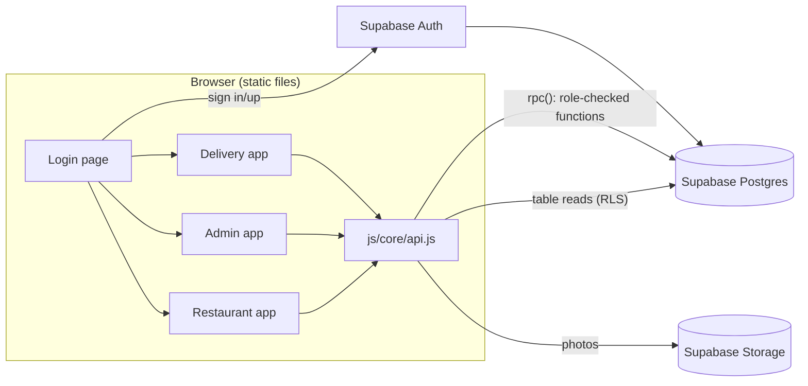
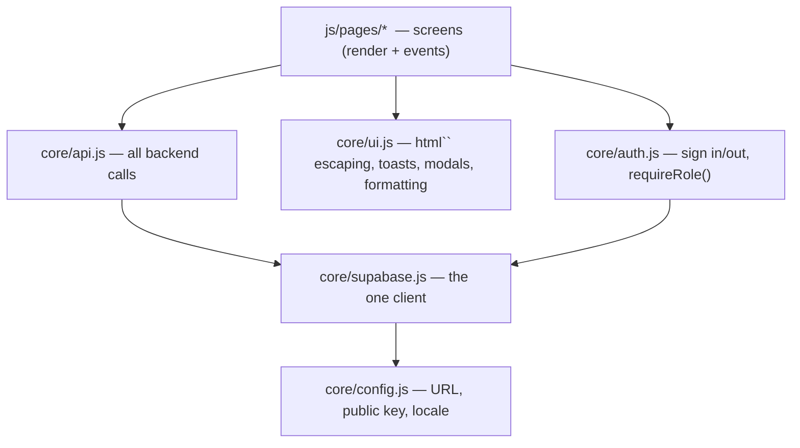
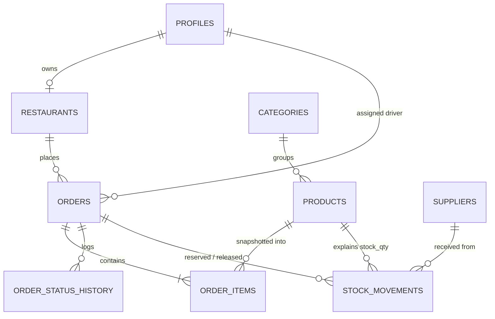
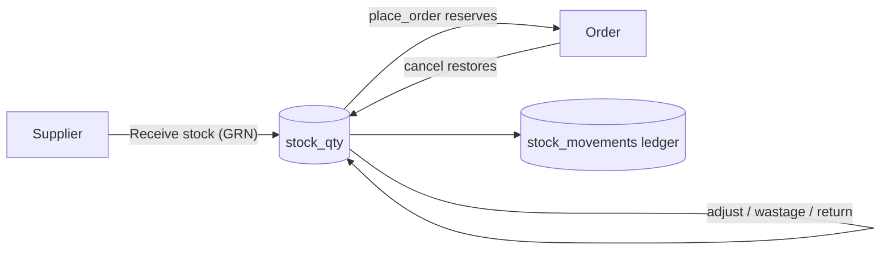
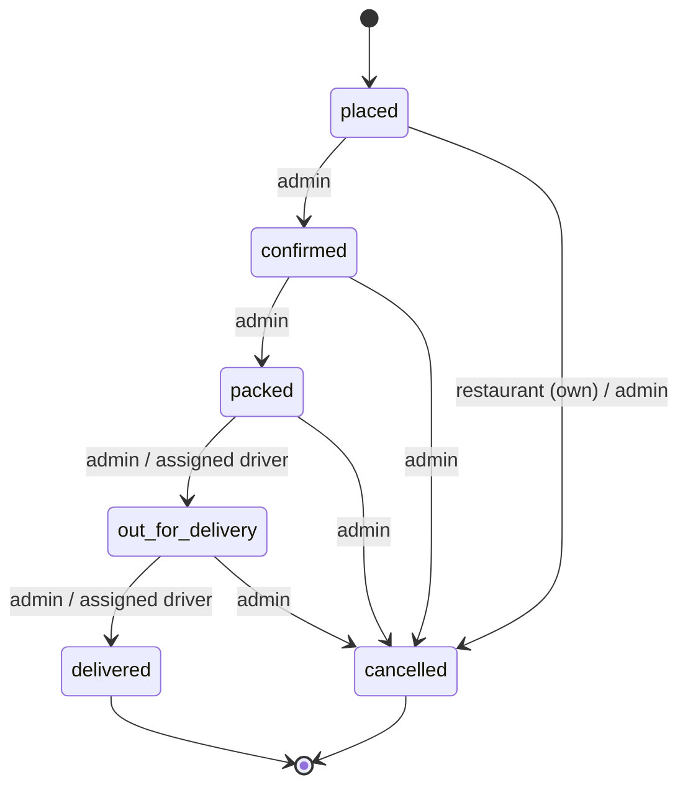
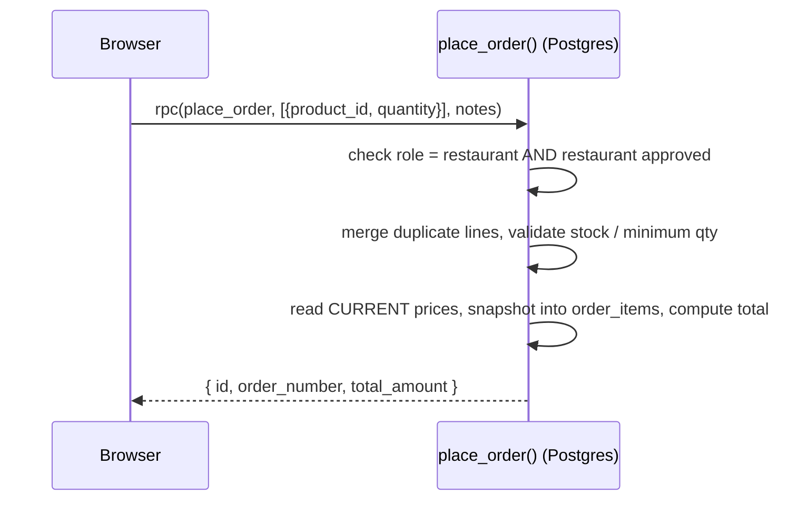

# Architecture

## Overview

The public site, three login areas and three apps are all static files. There is **no custom API server**; the browser talks straight to Supabase:

* **Reads** use table queries, filtered by Postgres **Row Level Security (RLS)**.
* **Writes that matter** (placing orders, changing status, managing users) call
  **Postgres functions** through `supabase.rpc()`. Each function re-checks the caller's role.
* The browser's API key is *publishable* (public by design). Direct writes to
  `orders`, `order_items`, `order_status_history` and `profiles` are revoked from browsers.



## Layers (frontend)



Rule: **pages never import the Supabase client directly** — they call `api.js`.
That keeps the data layer swappable and easy to test. (`shell.js` and `reset.js` use `auth.js` only.)

## Data model



`company_settings` is a single-row table with the seller details printed on invoices.

## Inventory

`products.stock_qty` is the quantity on hand. It is never edited directly: every change is a
row in `stock_movements` (reason: received, order, order_cancelled, adjustment, wastage,
returned) written by the internal `apply_stock_movement()` function.



Low stock = `stock_qty <= low_stock_threshold`; the admin dashboard and Inventory screen flag it,
and the restaurant catalogue shows "Only N left". Zero stock shows as out of stock.

Key decisions: orders **snapshot** product name, unit and price (later price edits never
change past orders); `line_total` is a generated column; money is `numeric(12,2)`.

## Order lifecycle



Dispatch requires an assigned driver. Enforced in `set_order_status()`, not in the UI.

## Placing an order



The browser never sends a price. A tampered cart cannot change what is charged.

## Security model (summary)

1. Anonymous users can read only listed products and categories (for the public site).
2. Sign-up always creates role `restaurant`, status `pending` (role never read from user input).
3. Admins and delivery staff are created by invitation and promoted by an admin.
4. RLS limits reads: restaurants see their own orders; drivers see assigned orders; admins see all.
5. Every `SECURITY DEFINER` function sets `search_path = ''` and re-checks the role.
6. All HTML is built with the escaping `html` template, preventing XSS.

The 30-check regression test in `supabase/tests/security_test.sql` proves these rules.

## Cities, scope and permissions (migration 006)

```
city ──< warehouse ──< service_zone (pin code)
  │          │
  │          └──< warehouse_stock (per product)      products.stock_qty = sum over warehouses
  └──< restaurants (customer: sector_code, warehouse_id from pin code)
            └──< orders (city_id, warehouse_id, sector_code, po_reference, delivery_fee)

profiles.team_role ──> role_permissions (module × action)     has_permission(module, action)
profiles.city_id / warehouse_id                                in_my_scope(city, warehouse)
audit_log  <── write_audit_log() trigger on products, orders, restaurants, profiles, permissions, settings
```

Every admin-app function and policy asks those two questions. The browser asks the same ones
(`web/js/core/permissions.js`) only to decide what to show.

## Pricing (migration 009)

```
benchmark_prices ─┐                         ┌─ products.price / market_price / benchmark_label
stock_movements ──┼─► pricing_inputs() ─► compute_price_from() ─► apply_prices() ─┼─ price_history (why)
pricing_rules ────┤   (override → category   (the formula; mirrored     (guard, now or   └─ scheduled_prices → publish_due_prices()
product_pricing ──┘    → global, costs, bm)   by pricing.js)              scheduled)
```
The browser previews with `web/js/core/pricing.js`; the database recomputes before writing. Every table in
the left column is staff-only (`pricing` permission module). Order lines snapshot HSN on `order_items` and
landed cost in `order_line_costs`. Details: `docs/modules/pricing.md`, ADR 0013.
